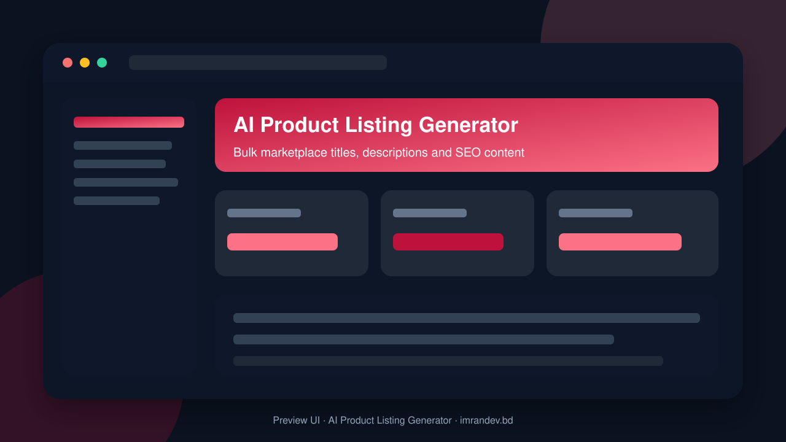
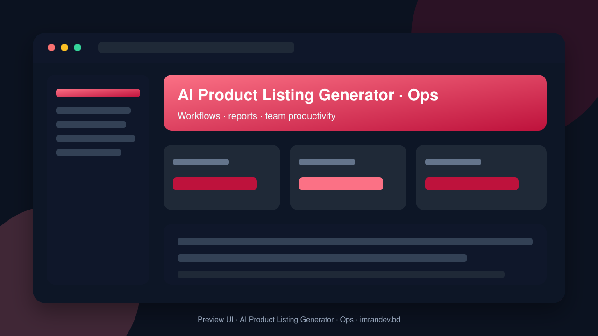

<p align="center">
  
</p>

# AI Product Listing Generator

<p align="center"><strong>Bulk marketplace titles, descriptions and SEO content</strong></p>

<p align="center">
  <a href="https://github.com/imranbru99/ai-product-description-listing-generator"></a>
  
  
</p>

---

## Overview

**AI Product Listing Generator** — Bulk marketplace titles, descriptions and SEO content.

This README documents the **real application features** so GitHub and Google visitors can understand what the product does.

## Product screenshots

| Dashboard | Operations |
| :---: | :---: |
|  |  |

## Application features

### AI listing generation

- Bulk product description generation
- Marketplace titles, bullets and SEO copy
- Multi-channel listing templates (Amazon/Shopify-style)
- Brand tone / language controls
- Catalog import and batch jobs
- Revision history and approve-before-publish flow
- Image-aware content suggestions
- Export-ready listing packages

### Detailed modules from product specification

- **Modular system (the heart of the product)**
- **Multi-tenancy**
#### Users, roles and panels (multi-type users)

- COMPLETE MODULE LIST (build ALL; each toggleable per section 3.1)
- PUBLIC WEBSITE (must showcase EVERY feature in the README)
- DEMO DATA AND DEMO USERS (mandatory, full end-to-end)
- UX AND QUALITY REQUIREMENTS
- DELIVERY PLAN (execute in this order; commit after each phase; run tests after each)
- DOCUMENTATION DELIVERABLES

### Admin screens (Filament resources)

- Brand Voice management
- Bulk Job management
- Client Listing management
- Feed management
- Marketplace Rule management
- Module management
- Partner Payout management
- Partner Referral management
- Plan management
- Product management
- Product Listing management
- Template management
- User management
- Workspace management

### Domain data models

- Affiliate
- Affiliate Payout
- Affiliate Referral
- Announcement
- Article
- Article Category
- Audit Log
- Brand
- Brand Voice
- Bulk Job
- Bulk Job Item
- Category
- Channel Connection
- Channel Sync Log
- Collection
- Comment
- Credit Transaction
- Feature Flag
- Feed
- Integration
- Invoice
- Lead
- Listing Review
- Listing Version
- Marketplace Rule
- Module
- Plan
- Product
- Product Image
- Product Listing
- Product Variant
- Project
- Setting
- Task
- Template
- Ticket
- Ticket Reply
- Webhook
- Webhook Delivery
- Workspace
- Workspace Module

## Tech stack

- PHP 8.2+ / Laravel
- Filament admin (where enabled)
- Migrations, seeders, queues
- Vite asset pipeline
- MySQL / SQLite ready

## Quick start

```bash
git clone https://github.com/imranbru99/ai-product-description-listing-generator.git
cd ai-product-description-listing-generator
composer install
cp .env.example .env
php artisan key:generate
php artisan migrate --seed
npm install && npm run build
php artisan serve
```

## Author

**Imran Ahmed** · https://imrandev.bd · me@imrandev.bd  
GitHub: https://github.com/imranbru99/ai-product-description-listing-generator

---
## 🤝 Let's Connect & Collaborate

I am open to **Senior Remote Full-Stack Roles**, AI Platform Architecture Contracts, and Enterprise Technical Advisory.

| Channel | Link |
| :--- | :--- |
| Portfolio | https://imrandev.bd |
| GitHub | https://github.com/imranbru99 |
| LinkedIn | https://linkedin.com/in/imranbru99 |
| Email | me@imrandev.bd |
| WhatsApp | https://wa.me/8801576918420 |
| Packagist | https://packagist.org/packages/imrandevbd/ |

